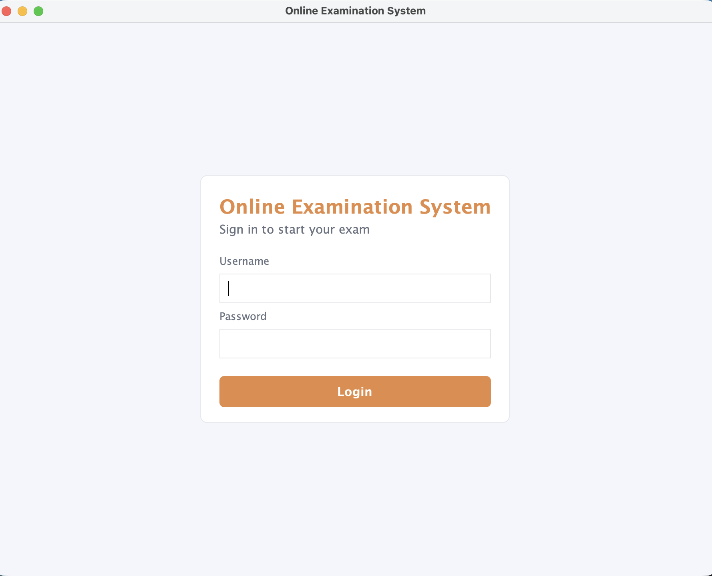
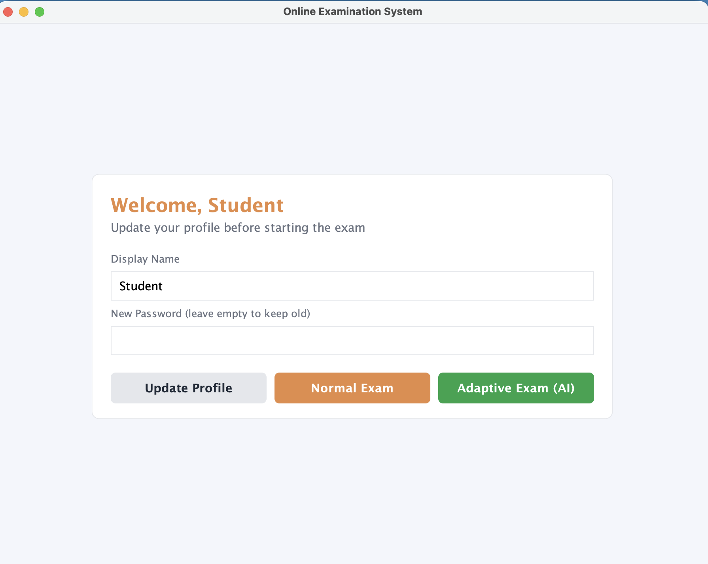
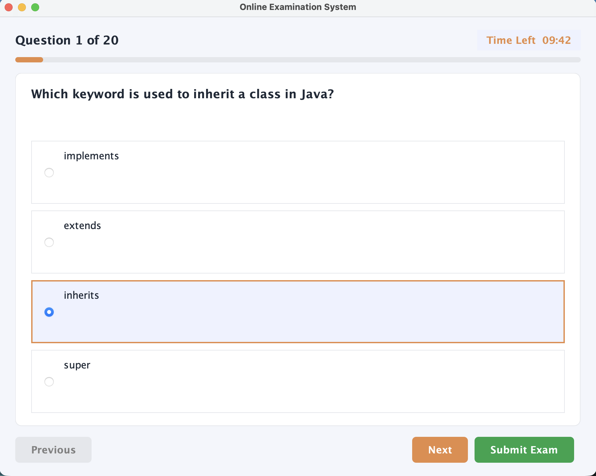
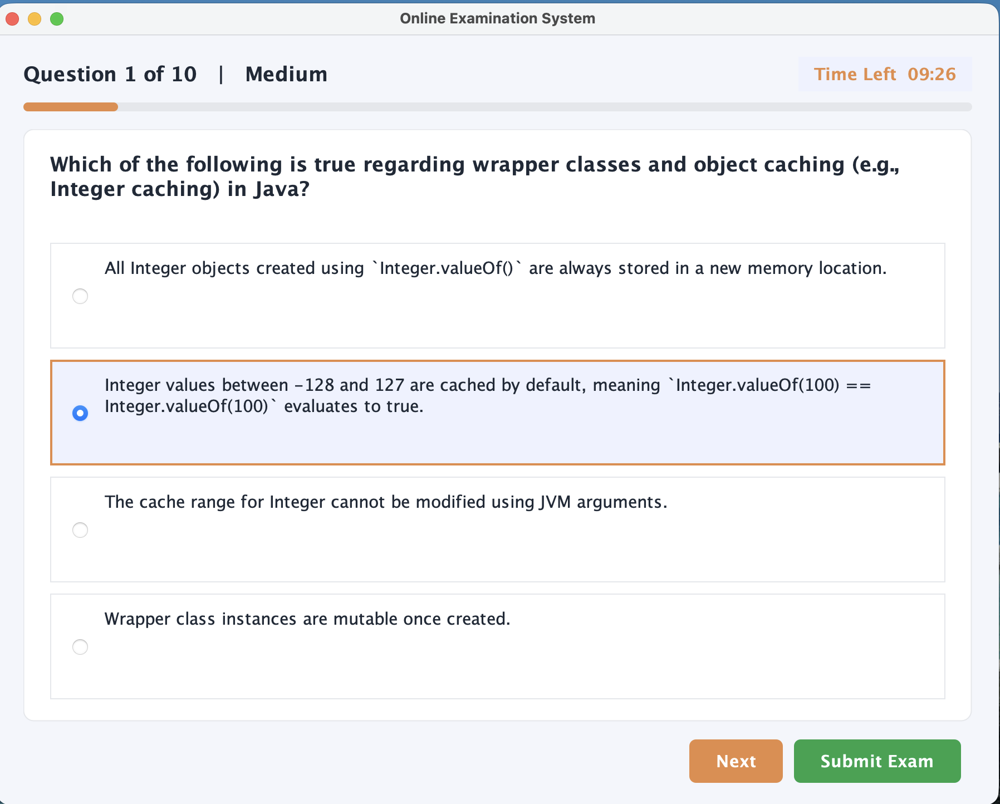
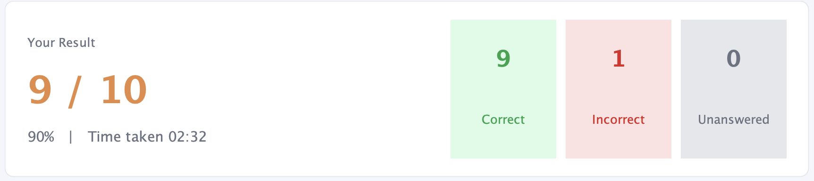
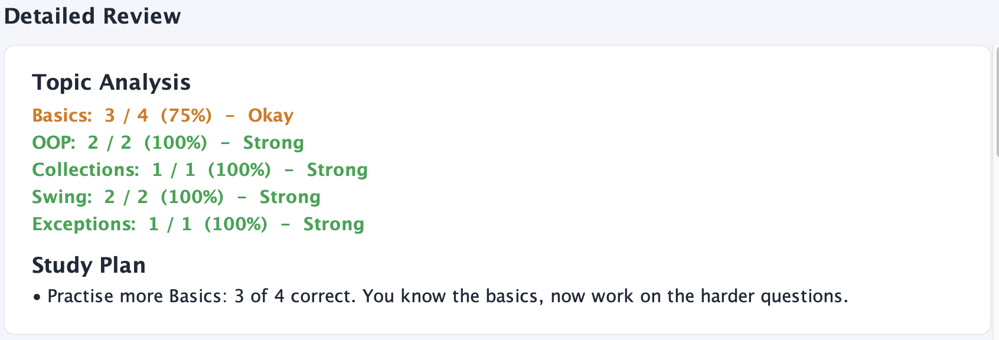

# Online Examination System (Java Swing)

OIBSIP Internship | Java Development | Task 4

A GUI-based examination system where students log in, answer multiple-choice
questions within a countdown timer, and get auto-submitted when time runs out.

## Features
- Login screen with username and password
- Profile update (display name and password, saved to a file)
- MCQ exam: one question at a time, 4 radio options, Next / Previous
- Countdown timer, auto-submit at zero
- Manual submit with confirmation dialog
- Result screen: score, time taken, correct / incorrect / unanswered breakdown
- Quit confirmation on window close
- Logout returns to the login screen

## AI-Inspired Features (Offline, Rule-Based)
- **Adaptive exam mode:** next question difficulty goes up after a correct
  answer and down after a wrong one.
- **Topic analysis:** topic-wise score with Weak / Okay / Strong labels.
- **Study plan:** tips generated from weak topics, unanswered questions
  and answering speed.
- **Explanations:** shown for every wrong or unanswered question.

No external API or machine learning model is used. All logic is rule-based
(see `AdaptiveEngine.java` and `StudyAdvisor.java`).

## Tech Stack
Java, Swing (JFrame, CardLayout, javax.swing.Timer, ButtonGroup, JRadioButton), File I/O

## Project Structure
```
src/
├── Main.java
├── model/    Question, User, ExamResult
├── service/  QuestionBank, AuthService, AdaptiveEngine, StudyAdvisor
└── ui/       MainFrame, LoginPanel, ProfilePanel, ExamPanel, ResultPanel, Theme, RoundedButton
```

## How to Run
1. Open the project folder in IntelliJ IDEA
2. Run `src/Main.java`
3. Login with `student` / `1234`

## Screenshots
| Login | Profile |
|---|---|
|  |  |

| Normal Exam | Adaptive Exam |
|---|---|
|  |  |

| Result | Analysis |
|---|---|
|  |  |

## Notes
- Passwords are stored in plain text in `users.txt` for learning purposes only.
  Real systems hash passwords (for example, BCrypt).
- `users.txt` is created on first run and is not committed to Git.

